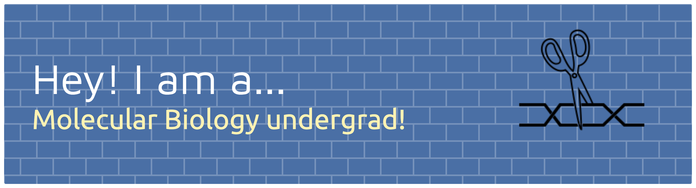
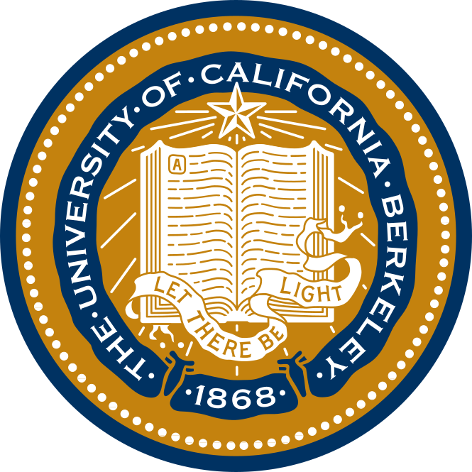
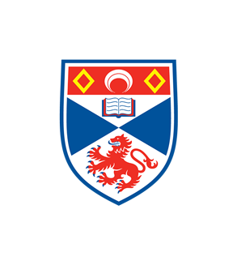

  

  
  &nbsp;&nbsp;&nbsp;&nbsp;&nbsp;&nbsp;&nbsp;&nbsp;
  

  <b>UC Berkeley</b> <i>(Visiting Exchange, 2026–27)</i> &nbsp;•&nbsp; <b>University of St Andrews</b> <i>(BSc Hons, Molecular & Cell Biology)</i>

---

### What I'm up to
- 🧬 **DNAForge × MTC Berkeley Hackathon:** Spending the day in Berkeley seeing how far a wet-lab biology background can go when paired with modern AI tools (DNAForge, Boltz, Modal).
- 🔬 **Wet lab to dry lab:** Currently taking upper-division Molecular & Cell Biology and intro data science classes at Cal—mostly trying to get better at writing Python to make sense of biological data.
- ⛵ **Outside the lab:** Usually out on the water sailing, on a squash court, or somewhere in the mountains.
